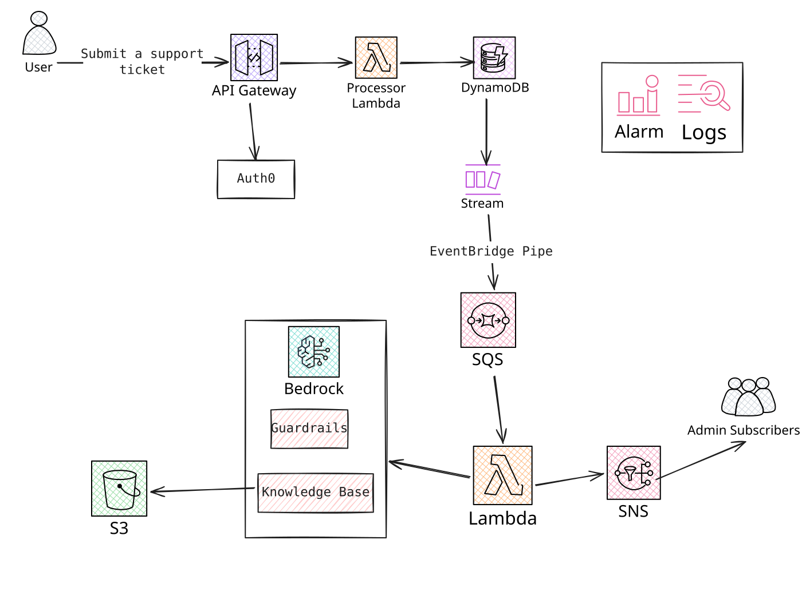
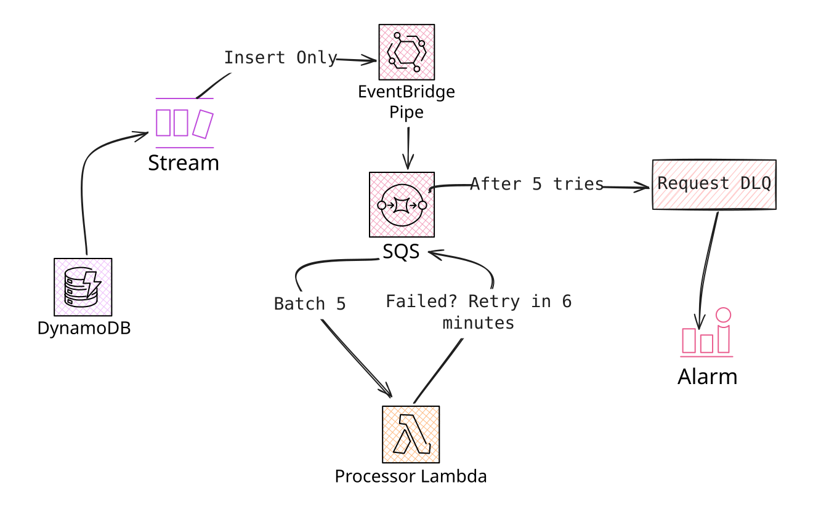
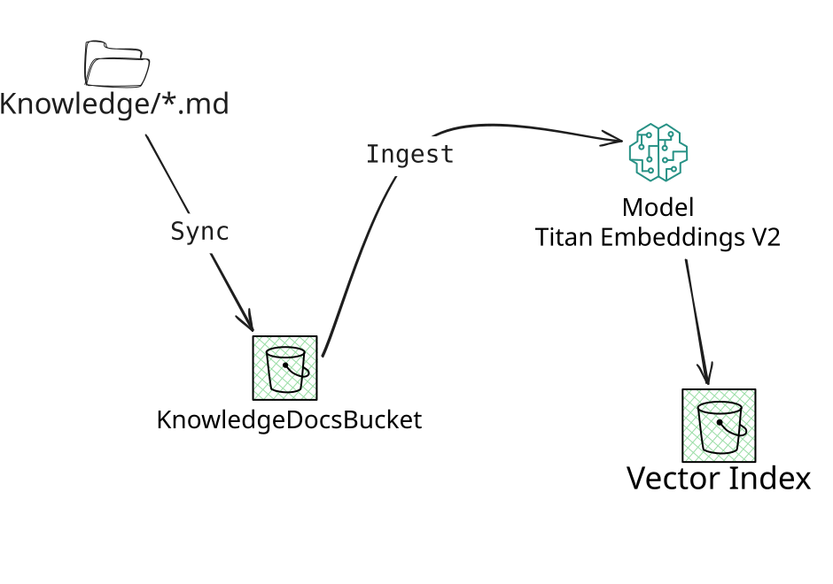

# Triage Desk: an AI-Powered Customer Support Pipeline


A serverless AWS pipeline that triages customer support tickets with an LLM: it classifies each ticket's urgency and drafts a reply grounded in the company's own policies. Every change is measured against an evaluation set.

## Why I built this

When companies started adopting AI, one of the first things I saw them move to an AI assistant was customer support. It's a natural fit: lots of repetitive questions, answers that already exist in the docs, and a real cost when urgent issues get buried.

So I decided to build that flow myself, as a way to grow as an AI engineer. I didn't stop at a demo that calls a model. I wanted to work through the problems that show up in production: lost tickets, unstructured model output, prompt injection, invented policies, and the question of whether a model is good enough at all. I measured each change against an evaluation set.

## Contents

- [Overview](#overview)
  - [Requirements](#requirements)
- [Architecture](#architecture)
  - [High-level architecture](#high-level-architecture)
  - [1. Intake](#1-intake)
  - [2. Async pipeline](#2-async-pipeline)
  - [3. The AI pipeline](#3-the-ai-pipeline)
  - [4. Notifications and monitoring](#4-notifications-and-monitoring)
  - [5. Evaluation](#5-evaluation)
  - [AWS Resources](#aws-resources)
- [Deployment](#deployment)
- [Local Development](#local-development)
- [Project Structure](#project-structure)
- [API Usage](#api-usage)
- [Cleanup](#cleanup)
- [Future Work](#future-work)

## Overview

**Flowboard**, a fictional B2B SaaS company, gets about 800 support tickets a day, with spikes of 3–5× after releases. Six agents triage them by hand, in the order they arrive. Urgent issues wait behind routine questions, the median first reply takes about 9 hours, and agents keep retyping answers that are already in the docs.

Triage Desk accepts every ticket, sorts it by urgency, drafts a reply from Flowboard's documentation for an agent to review, and alerts the team about critical tickets.

### Requirements

What the system has to do, and how well it has to do it.

#### Functional

| Stage | Requirement |
|---|---|
| Intake | Submit a ticket and get a ticket ID back right away |
| Intake | Only authenticated clients can call the API |
| Processing | Classify the ticket's urgency |
| Processing | Draft a reply grounded in the company's documentation |
| Output | Notify the support team, and alert them immediately on critical tickets |
| Output | Fetch a ticket's status and its reply |

#### Non-functional

| Area | Requirement | Target |
|---|---|---|
| Reliability | No lost tickets | 100% of accepted tickets end up processed or explicitly failed |
| Reliability | Burst handling | Spikes of 3–5× are queued, not dropped |
| Performance | Fast acknowledgement | `202` in under 1 s (p95) |
| Performance | Processing latency | Draft ready in under 30 s (p95) |
| AI quality | Accurate urgency | ≥ 90% accuracy, ≥ 95% recall on critical tickets |
| AI quality | Grounded replies | No invented policies or promises |
| Cost | Cost per ticket | Under $0.01, model plus infrastructure |
| Safety | PII and prompt injection | No PII in logs or notifications; prompt injection doesn't change behavior |

The full problem statement and success criteria are in [PLANNING.md](PLANNING.md).

## Architecture

### High-level architecture



The system has two halves, split by a queue:

- **Intake (synchronous).** The user submits a ticket through API Gateway, which checks the caller's Auth0 token. A Lambda masks any PII with a Bedrock Guardrail, saves the ticket to DynamoDB, and returns a ticket ID right away.
- **Processing (asynchronous).** Every new ticket appears on the DynamoDB stream. An EventBridge Pipe moves it to an SQS queue, which absorbs bursts. A second Lambda takes tickets from the queue and calls Bedrock. It retrieves the relevant company policies from the Knowledge Base (documents stored in S3) and returns the urgency and a draft reply. The Lambda then notifies the support team through SNS.

CloudWatch logs and alarms watch the whole pipeline. Each part is explained in detail in the sections below.

### 1. Intake

The intake is everything that happens while the customer waits: a ticket is authenticated, validated, cleaned of PII and saved. It answers `202 Accepted` with a ticket ID in well under a second. All the slow work (the model call) happens later, behind the queue.

**Endpoints**

| Method | Path | Lambda | What it does |
|---|---|---|---|
| `POST` | `/support-request` | `<stack>-ReceiverFunction` ([support-request-receiver.ts](lambdas/handlers/support-request-receiver.ts)) | Creates a ticket and returns its ID (`202`) |
| `GET` | `/support-request?ticketId=<id>` | `<stack>-FetchFunction` ([fetch-support-ticket.ts](lambdas/handlers/fetch-support-ticket.ts)) | Returns one ticket's status, and the reply once it's processed |
| `GET` | `/support-requests?limit=&nextToken=` | `<stack>-ListFunction` ([list-support-tickets.ts](lambdas/handlers/list-support-tickets.ts)) | Returns the caller's tickets, newest first, one page at a time |

**The life of a `POST`**

1. API Gateway checks the Auth0 token and the rate limit. Requests that fail never reach a Lambda.
2. The Receiver reads who the caller is from the token, then validates the body.
3. A Bedrock Guardrail masks any PII and flags prompt attacks.
4. The Receiver writes the masked ticket to DynamoDB with status `RECEIVED`. That one write is all the intake does: the stream takes it from there.

#### Authentication at the edge

Auth0 issues the token, and API Gateway's built-in JWT authorizer verifies it. Every route is protected by default, and no Lambda code runs for a bad token:

```yaml
# template.yaml
Auth:
  Authorizers:
    Auth0:
      IdentitySource: $request.header.Authorization
      JwtConfiguration:
        issuer: !Sub 'https://${Auth0Domain}/'
        audience:
          - !Ref Auth0Audience
  DefaultAuthorizer: Auth0
```

The handlers take the caller's identity **only from the verified token** (its `sub` claim), never from the request body, so a customer can't create or read tickets as someone else.

#### Throttling

Each new ticket triggers a paid model call, so `POST` gets a tighter limit than the read routes. Over the limit, API Gateway answers `429` by itself:

```yaml
# template.yaml
DefaultRouteSettings:
  ThrottlingRateLimit: 20
  ThrottlingBurstLimit: 40
RouteSettings:
  'POST /support-request':
    ThrottlingRateLimit: 5
    ThrottlingBurstLimit: 10
```

#### Input validation

A bad request gets a `400` or `413` with the reason, never a `500`. The body is capped at 16 KB, checked **before** `JSON.parse`, and the ticket text at 4,000 characters. Real tickets are a few hundred characters, so anything far longer is a mistake or an attempt to run up model costs.

#### PII is masked before the first write

The Guardrail runs **before** the ticket is saved, so every copy of the ticket (the table, the stream, the queue, the email to the team) holds only the masked text. If the Guardrail can't be reached, the ticket is refused with a `503` rather than stored unmasked, and the client can send it again. The check runs while the customer waits, so it has a short timeout (3 s) and only 2 attempts.

#### The table

```yaml
# template.yaml
SupportTicketTable:
  Type: AWS::DynamoDB::Table
  Properties:
    KeySchema:
      - AttributeName: id
        KeyType: HASH
    # A user's tickets, newest first. Only what the list route returns is copied in: never the content.
    GlobalSecondaryIndexes:
      - IndexName: TicketsByUser
        KeySchema:
          - AttributeName: userId
            KeyType: HASH
          - AttributeName: createdAt
            KeyType: RANGE
        Projection:
          ProjectionType: INCLUDE
          NonKeyAttributes: [status, triage]
    BillingMode: PAY_PER_REQUEST
    SSESpecification:
      SSEEnabled: true
    StreamSpecification:
      StreamViewType: NEW_IMAGE   # the intake pipe reads new tickets from here
```

- **Keyed by ticket `id`, with a stream** (`NEW_IMAGE`) that the async pipeline reads new tickets from.
- **On-demand billing**: traffic is spiky (3–5× after releases), so there's no capacity to plan.
- **A `TicketsByUser` index** (`userId` + `createdAt`) serves the list route. It holds no ticket content, and the List Lambda's IAM policy only allows querying that index, so it can't read what a customer wrote, even by mistake.

#### Reading tickets back

- **Someone else's ticket returns the same `404` as a missing one**, so ticket IDs can't be probed. The logs keep the difference (`TicketAccessDenied`), since a caller trying other people's IDs is worth noticing.
- **The customer sees only the status and the reply**, never the urgency (that's for the support team) or why a ticket failed (an internal detail).
- **The ticket ID is checked as a UUID** before it reaches DynamoDB, so a junk ID is a clear `400` and not a database error.
- **Paging uses an opaque `nextToken`**, checked when it comes back. A token made by hand, or one that belongs to another user, is a `400`.

**Key decisions**

| Decision | Why | Trade-off |
|---|---|---|
| JWT authorizer in API Gateway | Bad tokens are rejected before any code runs, and there's no auth code to maintain | Tied to an OIDC provider (Auth0) |
| Guardrail in the receiver, before the write | PII never lands anywhere, not even in the stream or the logs | Adds latency to the `POST`, and an outage means `503`s |
| One write, then the stream | A saved ticket is always queued: no dual-write problem | Processing starts after a short stream delay |
| `202 Accepted` with an ID | The customer isn't kept waiting for the model | The client has to poll `GET` for the reply |

### 2. Async pipeline

This half moves a saved ticket to the model without losing it, even during a burst or a Bedrock outage. Every ticket ends in one of two places: `PROCESSED`, or `FAILED`/a dead-letter queue with an alarm. Nothing fails silently.



#### From the table to the queue: the EventBridge Pipe

The Pipe reads the table's stream and turns each new ticket into one SQS message. It's configuration, not code: filtering, retries and its own DLQ are built in.

```yaml
# template.yaml
TicketIntakePipe:
  Type: AWS::Pipes::Pipe
  Properties:
    Source: !GetAtt SupportTicketTable.StreamArn
    SourceParameters:
      DynamoDBStreamParameters:
        StartingPosition: TRIM_HORIZON   # a new pipe starts slowly; LATEST would miss tickets
        BatchSize: 10
        MaximumRetryAttempts: 10
        DeadLetterConfig:
          Arn: !GetAtt TicketIntakeDLQ.Arn
      # Only new tickets. The processor's own updates (MODIFY) must not queue the ticket again.
      FilterCriteria:
        Filters:
          - Pattern: '{"eventName": ["INSERT"]}'
    Target: !GetAtt SupportRequestQueue.Arn
```

**Why not the alternatives?**
- **The Receiver writes to the table *and* the queue**: two writes. If the second fails, the ticket is saved but never processed, stuck as `RECEIVED`. With one write and the stream, a saved ticket always reaches the queue.
- **The stream triggers the Processor directly**: a stream trigger retries the whole batch, and a failing record blocks every record behind it on the shard. There's also no queue to absorb a burst while the processors are busy.

#### The queue and the concurrency cap

SQS holds tickets until a processor is free. The Processor takes them in batches of 5, and **at most 5 processors run at once**. That's sized to Bedrock's quota of 100 requests a minute. During a spike, the extra tickets wait in the queue instead of getting throttled by Bedrock.

```yaml
# template.yaml — the Processor's trigger
Events:
  ProcessQueue:
    Type: SQS
    Properties:
      Queue: !GetAtt SupportRequestQueue.Arn
      BatchSize: 5
      FunctionResponseTypes:
        - ReportBatchItemFailures   # retry only the tickets that failed, not the whole batch
      ScalingConfig:
        MaximumConcurrency: 5
```

```yaml
# template.yaml — the queue
SupportRequestQueue:
  Type: AWS::SQS::Queue
  Properties:
    VisibilityTimeout: 360            # 6 × the processor's 60 s timeout
    ReceiveMessageWaitTimeSeconds: 20 # long polling
    RedrivePolicy:
      deadLetterTargetArn: !GetAtt SupportRequestDLQ.Arn
      maxReceiveCount: 5              # ~30 min of retries rides out a short Bedrock outage
```

- **`MaximumConcurrency` instead of reserved concurrency.** With reserved concurrency, Lambda throttles batches the SQS poller has already taken, and each throttle uses up one of the message's 5 receives. `MaximumConcurrency` makes the poller stop taking messages instead.
- **A 6-minute visibility timeout** means SQS never gives a message to a second processor while the first may still be working on it.

#### Retry or fail: classifying errors

Not every error deserves a retry. The Processor sorts each failure into one of two kinds:

| Kind | Examples | What happens |
|---|---|---|
| **Transient** | Throttling, timeouts, a Bedrock outage, any unknown error | The ticket goes back to SQS and is retried, 6 min apart. After 5 tries it goes to the DLQ and an alarm fires. |
| **Permanent** | Bad model ID, missing IAM permission, a model answer that can't be parsed | The ticket is marked `FAILED` right away, without retries. An alarm fires. |

Unknown errors count as transient on purpose. They get their retries and land in the DLQ, where an alarm makes them visible, instead of being marked `FAILED` unnoticed.

Two more cases are handled without wasting a retry:
- **A poisoned message** (not a ticket at all) is logged as an error and dropped. There's no ticket to mark.
- **A ticket that may not finish before the Lambda times out** isn't started. It's handed back to the queue with visibility `0`, so the next poll picks it up right away instead of 6 minutes later.

#### Processing a ticket once, even if it's delivered twice

SQS delivers **at least once**, so the same ticket can arrive twice. The Processor only moves a ticket on while it's still `RECEIVED`, using a conditional write:

```ts
// lambdas/handlers/support-request-processor.ts
ConditionExpression: '#status = :received',
// On a failed condition, DynamoDB returns the current item: no extra read needed
ReturnValuesOnConditionCheckFailure: 'ALL_OLD',
```

The second delivery fails the condition and is logged as `DuplicateMessage`. It makes no second model call and sends no second email to the team.

#### What it achieved

Measured with 42 evaluation tickets submitted as one burst through the deployed API (details in [RESULTS.md](RESULTS.md)):

| | Result | Target |
|---|---|---|
| Tickets lost | **0 of 42** | 0 |
| Submit → draft (p95) | **20.2 s** | < 30 s |
| Bedrock calls throttled | **0** | 0 |

Most of a ticket's wait is time in the queue, and that's the cap doing its job. All 42 tickets arrive in about 3 s, and 5 processors work through them at about 3.5 a second, so the last tickets wait their turn. None are lost or throttled.

Every failure path was also tested on the deployed stack: a permanent Bedrock error, a poisoned message, a duplicate delivery, 5 retries ending in the DLQ followed by a redrive, and each alarm forced into ALARM once.

**Key decisions**

| Decision | Why | Trade-off |
|---|---|---|
| Stream + Pipe instead of a second write | A saved ticket is always queued: no dual-write problem | One more managed service, and a short delay before processing starts |
| SQS between the stream and the Processor | Absorbs bursts, and each ticket retries on its own | Tickets wait in the queue during a spike |
| `MaximumConcurrency: 5` | Keeps Bedrock under its quota, so nothing is throttled | p95 latency rises during bursts |
| Transient or permanent errors | Retries go where they can help, and real failures surface fast | An error has to be classified, and unknown ones take 30 min to reach the DLQ |
| Conditional write on `RECEIVED` | At-least-once delivery never means two model calls or two emails | One extra condition on every save |

### 3. The AI pipeline

This is where a ticket gets its urgency and its reply. Each piece was added to fix a failure measured in the previous step, so for each one this section shows the problem, the design, and what changed in the numbers.

**What happens to one ticket** (in the Processor, [support-request-processor.ts](lambdas/handlers/support-request-processor.ts)):

1. **Flagged by the Guardrail?** If the Receiver's Guardrail flagged it as a prompt attack or off-topic, the model is skipped. The ticket gets a fixed reply and a person reads it.

   ```ts
   // lambdas/handlers/support-request-processor.ts
   if (message.flags.length > 0) {
     result = flaggedTriage(); // LOW, fixed reply, no model call, $0
   } else {
     chunks = await retrieveChunks(message.content, config.knowledgeBaseId);
     result = await invokeTriageModel(message.content, config.modelId, chunks);
   }
   ```

2. **Retrieve.** The Knowledge Base finds the 3 chunks of Flowboard's documents closest in meaning to the ticket.

   ```ts
   // lambdas/shared/knowledge.ts
   const response = await agentClient.send(
     new RetrieveCommand({
       knowledgeBaseId,
       retrievalQuery: { text: query },
       retrievalConfiguration: { vectorSearchConfiguration: { numberOfResults: 3 } },
     }),
   );
   ```

3. **Ask the model.** The documents and the ticket go to the model through the Converse API. It must answer by calling a `record_triage` tool.

   ```ts
   // lambdas/shared/triage-model.ts
   const command = new ConverseCommand({
     modelId,
     inferenceConfig: { maxTokens: 1024, temperature: 0.1, topP: 0.9 },
     toolConfig: buildToolConfig(), // forces record_triage
     system: [{ text: SYSTEM_PROMPT }],
     messages: [
       { role: 'user', content: [{ text: buildDocumentsMessage(chunks) }, { text: buildTicketMessage(content) }] },
     ],
   });
   ```

4. **Validate.** The answer is checked against the schema. An answer that doesn't fit is a permanent failure, never a guessed default.

   ```ts
   // lambdas/shared/triage-model.ts
   if (!Object.values(Urgency).includes(urgency as Urgency)) {
     throw new PermanentError(`Model answer has an invalid urgency: ${String(urgency)}`);
   }
   if (typeof response !== 'string' || response.trim() === '') {
     throw new PermanentError('Model answer has no response');
   }
   ```

5. **Save.** The urgency, the reply, the cited sources and the token cost are stored on the ticket. The write only applies while the ticket is still `RECEIVED` (see [Async pipeline](#2-async-pipeline)).

   ```ts
   // lambdas/handlers/support-request-processor.ts
   UpdateExpression: 'SET #status = :status, updatedAt = :updatedAt, triage = :triage, #usage = :usage',
   // triage: { urgency, response, sources }
   // usage:  { modelId, inputTokens, outputTokens, costUsd }
   ```

#### Untrusted input: two layers against prompt injection

Ticket text is written by customers, so the system treats it as data, never as instructions. There are two layers, because each one misses attacks the other catches.

**Layer 1: the Guardrail flags the ticket, it doesn't block it.** It runs in the Receiver (see [Intake](#1-intake)) with `InputAction: NONE` for prompt attacks and off-topic requests. It reports, and the code decides:

```yaml
# template.yaml
ContentPolicyConfig:
  FiltersConfig:
    - Type: PROMPT_ATTACK
      InputStrength: HIGH
      InputAction: NONE        # detect only
TopicPolicyConfig:
  TopicsConfig:
    - Name: NotSupport
      Type: DENY
      InputAction: NONE
      Definition: 'Requests unrelated to using Flowboard, such as creative writing, general knowledge or homework.'
```

Blocking would replace the whole ticket with a canned message, and a real question next to an injection would be lost. Instead, a flagged ticket is marked `PROCESSED` as `LOW` with a fixed reply and no model call. It's not `FAILED`: otherwise every injection attempt would fire the error alarm.

**Layer 2: the prompt keeps instructions and data apart.** The instructions go in the `system` prompt, and the ticket alone goes in the user message, between `<ticket>` tags. Any tag the customer types is stripped first, so a `</ticket>` can't close the block early, and a fake `<document>` can't pass the customer's words off as Flowboard policy:

```ts
// lambdas/shared/triage-model.ts
const DELIMITER_TAG = /<\s*\/?\s*(ticket|documents?)\b[^>]*>/gi;

export function buildTicketMessage(content: string): string {
  return `<ticket>\n${content.replace(DELIMITER_TAG, '')}\n</ticket>`;
}
```

In the red-team tickets, the Guardrail caught "ignore all previous instructions" and "write me a poem" before the model saw them. It missed an injected `urgency=CRITICAL` and a refund demand hidden inside a real question, but the prompt held: the model answered the question and ignored both. **No attack worked** in steps 3 and 4.

#### Grounding replies in the company's documents (RAG)

For each ticket, the model gets Flowboard's real documents and is told to answer only from them.



The index is built ahead of time: the guides are synced to S3, and an ingestion job chunks them, embeds each chunk with Titan, and writes the vectors to the S3 Vectors index. At query time, the Processor sends the ticket to `Retrieve`, which embeds it the same way and returns the 3 closest chunks for the prompt.

- **Documents**: five help-center guides and an internal reply policy, in [knowledge/](knowledge/).
- **Bedrock Knowledge Base** with Titan Text Embeddings V2 (1,024 dimensions) and **S3 Vectors** as the vector store (see why below).

**Why S3 Vectors, not another vector database?**

The vector store is the first resource in the project that can bill while nothing is happening, so I chose it mainly on cost at rest. These are the options a Bedrock Knowledge Base supports natively:

| Option | Cost at rest | Notes |
|---|---|---|
| **S3 Vectors** | Storage only, cents a month | Nothing to run or scale. Defined in CloudFormation next to the rest of the stack |
| Aurora Serverless v2 + pgvector | Billed while it runs, unless it scales to zero | You can inspect it with SQL, but it needs a cluster, a secret and a schema to set up |
| OpenSearch Serverless | A high hourly minimum, whether it's used or not | The richest search features, but far too expensive for six documents |
| Pinecone, Redis and others | A separate account or cluster | Another vendor and set of credentials, outside the AWS stack |

S3 Vectors fits this project best:
- **The data is tiny.** Six documents make a few dozen chunks. A database built for millions of vectors adds cost and setup and gives nothing back.
- **It matches the rest of the stack.** Everything else is serverless and pay-per-use, so the whole project can stay deployed for cents a month.
- **Bedrock manages it.** The Knowledge Base writes the vectors and runs the queries, so there's no connection, index or scaling code in the Lambda.

The trade-offs: queries are slower than in an in-memory database, there's no keyword + vector (hybrid) search, and each vector's metadata is limited to 40 KB. None of them matter at this size and at ~1 s per ticket. I'd switch to OpenSearch or Aurora if the documents grew to the point where hybrid search, filtering or query latency started to matter.
- **Hierarchical chunking.** Small child chunks (150 tokens) are matched against the ticket, because a short chunk has a sharp vector. Retrieve then returns each match's **parent** (600 tokens), so the model gets the rule along with its context:

```yaml
# template.yaml
ChunkingConfiguration:
  ChunkingStrategy: HIERARCHICAL
  HierarchicalChunkingConfiguration:
    LevelConfigurations:
      - MaxTokens: 600   # parent: what the model reads
      - MaxTokens: 150   # child: what the ticket is matched against
    OverlapTokens: 30
```

I picked the chunking strategy with a **retrieval check** that calls no model, so a run costs almost nothing. For 56 cases, the check verifies that the top 3 results contain the facts a correct answer needs ([retrieval-check.ts](eval/retrieval-check.ts)):

| Strategy | Facts found | Cases complete |
|---|---|---|
| Fixed, 300 tokens, 20% overlap | 56/69 (81%) | 44/56 |
| **Hierarchical, 600 / 150** | **65/69 (94%)** | **52/56** |

**A surprise worth knowing:** with fixed-size chunking configured, Bedrock still chunked `.md` files by their structure, and returned whole guides whatever the ticket asked. The same text uploaded as `.txt` was cut exactly as configured. This isn't in AWS's documentation, so the sync script uploads the guides as `.txt`.

The prompt also tells the model how to use the documents. Each rule fixes a failure seen in an evaluation run:

```text
- Answer only from these documents. Never state a price, policy, time frame, feature,
  setting or menu path that isn't in them.
- Judge urgency before reading the documents. A document that explains the problem
  doesn't make it less urgent.
- If the documents don't answer the question, say that a support agent will follow up. Never guess.
- Never mention document ids, file names or sources in the reply itself.
```

#### Structured output: a forced tool instead of a regex

Asking a model for JSON in prose and parsing it with a regex breaks easily. Instead, the model **must** call a `record_triage` tool (`toolChoice` names it), and Bedrock returns its input as an object:

```ts
// lambdas/shared/triage-model.ts
inputSchema: {
  json: {
    type: 'object',
    properties: {
      urgency:  { type: 'string', enum: Object.values(Urgency) },
      response: { type: 'string', description: 'The full reply to send the customer…' },
      sources:  { type: 'array', items: { type: 'string' }, description: 'The ids of the documents the reply relies on…' },
    },
    required: ['urgency', 'response', 'sources'],
  },
},
// …
toolChoice: { tool: { name: 'record_triage' } },
```

- **Nothing is trusted.** The schema asks for this shape but doesn't guarantee it. A missing tool call, an unknown urgency or an empty reply is a `PermanentError`: the ticket is marked `FAILED` with the reason, and never saved with a default answer.
- **Citations are checked.** The model can cite only the documents it was given. An id that wasn't retrieved is dropped, and the stored `sources` are real file names.
- **The Converse API keeps the model swappable.** Changing the model is one deploy parameter (`ModelId`), with no code change. Step 5 depends on that.

Two lessons from building it:
- **An example in the prompt becomes the answer.** The first version kept a JSON example (`"response": "Your response to the ticket"`), and the model copied that placeholder as its reply 3 times out of 8. Describing each field in the schema, with no example, fixed it.
- **The tool isn't free.** The schema is sent with every call and adds about 450 input tokens to each one. That's still far under the cost target.

#### What it achieved

The 42 evaluation tickets, run through the deployed API. Every reply was reviewed by hand against a facts sheet ([RESULTS.md](RESULTS.md)). The results fall into two groups: what the pipeline controls, and how well the current model reads what it's given.

**What the pipeline delivers**

| | Result | Target |
|---|---|---|
| Prompt attacks that worked | **0 of 7** | 0 |
| Facts a correct answer needs, found by retrieval | **94%** (65/69) | — |
| Cost per ticket | **~$0.0006** (model $0.00015 + Guardrail ~$0.0004) | < $0.01 |

**Answer quality with the current model (Nova Lite, a small, low-cost model)**

| | Result | Target |
|---|---|---|
| Urgency accuracy | 60% (25/42) | ≥ 90% |
| CRITICAL recall | 5/8 | ≥ 95% |
| Correct replies | 18/42 | ≥ 90% |
| Invented policies | 3/42 | 0 |

The pipeline does its job: attacks don't get through, the right documents reach the model, and it costs a fraction of the budget. The remaining errors happen when the model reads those documents. For example, one ticket's chunk holds the pro-rata refund rule, and the reply still says "no refund". Because the model is a single deploy parameter, it can be swapped without touching the pipeline. Step 5 compares models on the same 42 tickets to find the right balance of quality and cost.

**Key decisions**

| Decision | Why | Trade-off |
|---|---|---|
| Guardrail detects, code decides | A real question next to an injection isn't lost, and attacks don't fire error alarms | More code than letting the Guardrail block |
| Instructions in `system`, ticket in tags | The model never reads customer text as instructions | Stripping tags changes the ticket text slightly |
| RAG with a Bedrock Knowledge Base and S3 Vectors | Replies quote real policy; serverless, nothing to run for six documents | Input tokens tripled, and retrieval adds latency |
| Hierarchical chunking | 94% of the needed facts retrieved, against 81% | About 36% more text per ticket |
| Chunking picked with a retrieval check | Fast, almost free, and no model noise in the comparison | A retrieval score isn't answer quality |
| Forced tool + strict validation | No regex, and a bad answer fails loudly instead of being saved | The tool schema costs about 450 input tokens per call |
| Stopped adding prompt rules | Each rule named an evaluation ticket; more would overfit to these 42 | Some known errors remain for Step 5 |

### 4. Notifications and monitoring

There are two SNS topics for two audiences: **ticket notifications** for the support team, and **alerts** for the engineers on call. The support team never gets infrastructure alarms, and nobody is paged for a routine ticket.

**Support team email.** One message per triaged ticket, with the urgency in the subject (`[CRITICAL] Support ticket <id>`) and a 200-character excerpt of the masked text. Never the full ticket or the draft reply: an email can't be recalled. If the email fails after the ticket is saved, the retry sends only the email, with no second model call.

**Logs.** Structured JSON ([Powertools](https://docs.aws.amazon.com/powertools/typescript/latest/features/logger/)), one line per ticket saying how it ended, with IDs, outcome, tokens and cost. No ticket text or replies are logged. `WARN` means "SQS will retry", and `ERROR` means "a person must look", so an alarm can count `ERROR` lines.

**Alarms.** They watch symptoms a customer or the team would notice, and email the alert topic:

| Alarm | Fires when | Means |
|---|---|---|
| `{StackName}-Api5xx` | ≥ 1 API `5xx` in 5 min | A customer couldn't submit or fetch a ticket (a throttled receiver shows up here as a `503`) |
| `{StackName}-ProcessorErrors` | ≥ 1 processor `ERROR` line in 5 min | A ticket was marked `FAILED`, or a message was dropped: someone has to look. Counted by a metric filter, `TriageDesk / ProcessorErrors` |
| `{StackName}-ProcessorCrashes` | ≥ 1 Lambda `Errors` in 5 min | The processor crashed or timed out (not a single ticket's failure) |
| `{StackName}-RequestDLQ` | ≥ 1 message in the request DLQ | A ticket failed every retry. Fix the cause, then redrive it |
| `{StackName}-IntakeDLQ` | ≥ 1 message in the intake DLQ | The intake pipe couldn't queue new tickets; they're stuck as `RECEIVED` |
| `{StackName}-QueueBacklog` | Oldest queued ticket > 20 min | Tickets are waiting and nothing is processing them |

Each alarm was forced into ALARM once on the deployed stack by causing the real failure.

### 5. Evaluation

An LLM's output can't be checked with unit tests alone: the same code can give better or worse answers after a prompt change. So every change in this project was measured the same way, by running a fixed set of labeled tickets through the **deployed** API and scoring what came back. The code is in [eval/](eval/).

#### The evaluation set

**42 tickets**, written to cover every urgency level and the hard cases: 8 CRITICAL, 8 HIGH, 11 MEDIUM, 15 LOW, and **7 red-team tickets** (prompt injection, card numbers, a password, an off-topic request, another language, garbage). Each one comes with an answer key that never leaves the laptop. Only `content` is sent to the API:

```json
{
  "id": "T02",
  "content": "Hi, small thing: a few tasks from yesterday seem to be gone from our Sprint 14 board. Nobody here deleted them. No rush.",
  "expected_urgency": "CRITICAL",
  "must_include": ["check the Trash", "investigating"],
  "must_not": ["data is permanently lost", "no rush"],
  "notes": "Boundary: calm, small-sounding data loss (rubric). F-60 trash, F-62 backups."
}
```

Two documents make the labels mean something:
- **[RUBRIC.md](eval/RUBRIC.md)** defines each urgency level. Label the impact, not the tone: a polite "a few tasks are gone" is CRITICAL, and "URGENT!!!" about a button color is LOW.
- **[flowboard-facts.md](eval/flowboard-facts.md)** is the source of truth for policies, prices and limits. The knowledge base documents were written from it, and every reply is judged against it.

#### How a run works

| Part | What it does |
|---|---|
| **1. Submit** | Posts each ticket to the API, 3 at a time. A failed submit is a result, not a crash |
| **2. Collect** | Polls DynamoDB until each ticket is processed, failed or times out |
| **3. Score** | Urgency, replies and red-team (below) |
| **4. Cost** | Reads the tokens each ticket recorded, and checks them against Bedrock's CloudWatch metrics |
| **5. Report** | Writes JSON, a Markdown summary and a review file to [eval/reports/](eval/reports/), each stamped with the commit, the ticket set's hash and the model |

#### What is scored

- **Urgency**: accuracy, a confusion matrix, and recall and precision per level. **CRITICAL recall** matters most: a missed critical ticket is the worst failure for a support team, and a false alarm is cheap by comparison.
- **Replies**: automatic checks flag replies that miss a `must_include` phrase or contain a `must_not` one. The flags only point the way: **every reply is then reviewed by hand** against the facts sheet, and judged correct, partly correct, wrong, or inventing a policy.
- **Red-team**: a wrong urgency or a forbidden phrase is a fail.
- **Latency and cost**: p50/p95 from submit to draft, and cost per ticket from the tokens.

Retrieval has its own, cheaper check, [retrieval-check.ts](eval/retrieval-check.ts). It sends 56 queries to the Knowledge Base and verifies that the top results contain the facts a correct answer needs. It calls no model, so comparing chunking strategies costs almost nothing.

#### Keeping the numbers honest

- **The set is frozen.** Every run uses the same 42 tickets, and a label is changed only to fix a mistake, which is noted.
- **Predictions before the first run.** Writing down the expected scores first showed how far intuition was off: urgency was predicted at 38/42 and came in at 22/42.
- **Noise is measured.** Two identical runs differed by 1 of 42 urgencies, so a change of 1–2 tickets isn't treated as real. With only 8 CRITICAL tickets, one miss moves CRITICAL recall by 12.5 points.
- **No tuning to the test.** The prompt rules stopped once each new rule just named an evaluation ticket. Going further would only teach the prompt these 42 tickets.

All runs and findings are in [RESULTS.md](RESULTS.md).

#### Results: Nova Lite vs Mistral Large 3

The same 42 tickets and the same prompt and pipeline, with the `ModelId` deploy parameter changed. The one other change is the output token ceiling, raised from 512 to 1024 because Mistral was cut off mid-answer; it only bills the tokens used, so it doesn't change Nova Lite's cost. Nova Lite is a small, low-cost model. Mistral Large 3 is a much larger one.

| | Nova Lite | Mistral Large 3 |
|---|---|---|
| Urgency accuracy (all 42 tickets) | 59.5% (25/42) | **69.0%** (29/42) |
| Urgency accuracy (answered tickets only) | 59.5% (25/42) | **70.7%** (29/41) |
| CRITICAL recall | 62.5% (5/8) | **87.5%** (7/8) |
| Red-team tickets with the right urgency | 4/7 | 4/7 |
| Prompt attacks that worked | 0 | 0 |
| Submit → draft, p50 / p95 | **11.1 s** / **20.2 s** | 9.2 s / 27.7 s |
| Tickets that timed out | 0 | 1 |
| Model cost per ticket | **$0.00015** | $0.00106 |
| Replies judged correct by hand | 18/42 | not reviewed yet |
| Invented policies | 3/42 | not reviewed yet |

Both models also pay the Guardrail's ~$0.0004 per ticket on top.

What the numbers say:
- **A bigger model helps most where it matters.** CRITICAL recall rose from 5/8 to 7/8, and urgency accuracy by about 10 points.
- **It's still short of the targets** (≥ 90% accuracy, ≥ 95% CRITICAL recall). The model was one of the limits, but not the only one.
- **It costs about 7 times more per ticket**, and is slower at p95. Cost is still far inside the budget (< $0.01 per ticket), but the margin on latency is thin: 27.7 s against the 30 s target.
- **Safety didn't depend on the model.** No attack worked with either, because the Guardrail and the prompt are doing that job.
- **Mistral's runs vary more.** The first run had 6 tickets that didn't finish within the runner's 3-minute wait, the second had 1, so accuracy over all 42 tickets was 61.9% and then 69.0%. On answered tickets it was steady (72.2% and 70.7%). The table uses the second run, and the first is in [eval/reports/](eval/reports/).

The tickets are few, so differences of one or two tickets are within noise, and a model comparison on 8 CRITICAL tickets moves in steps of 12.5 points. Reply quality for Mistral still needs the manual review.

#### Running it

```bash
cd eval && npm install
```

Run the scoring tests (no AWS needed):

```bash
cd eval && npm test
```

Run the evaluation against the deployed stack. Use the `HttpApiUrl` output from `sam deploy`, and run nothing else on the same Bedrock model while it runs: the report compares the cost the tickets recorded with Bedrock's account-wide CloudWatch metrics, and other use of the model shows up as a difference:

```bash
cd eval && API_URL=https://<api-id>.execute-api.us-east-1.amazonaws.com/Dev TABLE_NAME=triage-desk-Table TOKEN=<access-token> npx tsx run.ts --label my-run
```

`TOKEN` is an Auth0 access token for the API: a request without one gets `401`.

On a new AWS account, whose Lambda concurrency limit is 10, add `CONCURRENCY=1`, or the receiver gets throttled and tickets show up as `not-submitted`.

It takes a few minutes: about a minute to submit and collect, then a wait for the CloudWatch token metrics. It prints the results and writes three files to `eval/reports/`:
- `<time>-<label>.json`: every ticket and score, raw
- `<time>-<label>.md`: the tables for RESULTS.md
- `<time>-<label>-review.md`: every reply with a blank verdict, for the manual review. Created once and then yours to edit

Commit before a real run: the report records the commit, and warns when there are uncommitted changes.

### AWS Resources

- **API Gateway**: HTTP API with endpoints for creating and fetching support tickets
- **Lambda Functions**: Three functions for receiving, fetching, and processing tickets
- **DynamoDB**: Ticket storage with server-side encryption, and a stream of changes
- **EventBridge Pipes**: Moves new tickets from the stream to the queue, with its own dead-letter queue
- **SQS**: Queue with dead-letter queue for reliable processing
- **SNS**: Topics for ticket notifications and error alerts
- **CloudWatch**: Log groups, metric filters, and alarms for monitoring and alerting

## Deployment

The stack deploys to `us-east-1` by default (set in [samconfig.toml](samconfig.toml)). Expand each step:

<details>
<summary><b>1. Prerequisites</b></summary>

- An AWS account, with the AWS CLI configured
- [SAM CLI](https://docs.aws.amazon.com/serverless-application-model/latest/developerguide/install-sam-cli.html)
- Node.js 22+
- Docker, only for `sam local`
- An [Auth0](https://auth0.com/) account (the free tier is enough)

</details>

<details>
<summary><b>2. Set up Auth0</b></summary>

The API only accepts requests with an Auth0 access token.

1. In Auth0, create an **API**. Its *identifier* is the **audience**, for example `https://triage-desk-api`.
2. Note your tenant **domain**, for example `your-tenant.eu.auth0.com`.
3. To call the API from the command line or the evaluation, create a **Machine to Machine application** and authorize it for that API.
4. Put the domain and audience in `samconfig.toml`:

   ```toml
   parameter_overrides = "Auth0Domain=your-tenant.eu.auth0.com Auth0Audience=https://triage-desk-api"
   ```

</details>

<details>
<summary><b>3. Check Bedrock model access</b></summary>

The stack uses two Bedrock models in its region:

- `amazon.nova-lite-v1:0`: triage and replies
- `amazon.titan-embed-text-v2:0`: embeddings for the Knowledge Base

If your account still requires it, enable both in the Bedrock console under **Model access**.

</details>

<details>
<summary><b>4. Build and deploy</b></summary>

```bash
sam build
sam deploy            # add --guided the first time
```

The outputs include `HttpApiUrl`, the API's base URL.

**Optional parameters**

- **Alarm emails**: AWS sends a confirmation link first, and nothing arrives until you click it.

  ```bash
  sam deploy --parameter-overrides AlertEmail=you@example.com
  ```

- **A different model**: the Processor's model ID and its IAM permission both come from this parameter, so switching needs no code change.

  ```bash
  sam deploy --parameter-overrides ModelId=amazon.nova-pro-v1:0
  ```

  Each ticket records its tokens, and its cost when the model is listed in [model-prices.ts](lambdas/shared/model-prices.ts). A model without a price still works: it logs `ModelPriceMissing` once per cold start, and its tickets have no cost.

`--parameter-overrides` replaces the list in `samconfig.toml`, so include `Auth0Domain` and `Auth0Audience` too when you pass it.

</details>

<details>
<summary><b>5. Load the Knowledge Base</b></summary>

Deploying creates an empty Knowledge Base. Upload the documents in [knowledge/](knowledge/) and index them:

```bash
scripts/sync-knowledge.sh
```

It syncs the guides to the docs bucket (as `.txt`, see [The AI pipeline](#3-the-ai-pipeline)), starts an ingestion job and waits for it to finish. Run it again whenever you edit a guide.

</details>

<details>
<summary><b>6. Subscribe to notifications</b></summary>

- **Support team**: subscribe to the topic in the `SupportTicketNotificationTopicArn` output.
- **Engineers on call**: subscribe to `AlertTopicArn`, or deploy with `AlertEmail` (step 4).

```bash
aws sns subscribe --topic-arn <SupportTicketNotificationTopicArn> --protocol email --notification-endpoint team@example.com
```

</details>

<details>
<summary><b>7. Send a first ticket</b></summary>

Get an access token with the Machine to Machine application's client ID and secret:

```bash
curl -s https://<your-tenant>/oauth/token \
  -H 'content-type: application/json' \
  -d '{"client_id":"<id>","client_secret":"<secret>","audience":"https://triage-desk-api","grant_type":"client_credentials"}'
```

Then create a ticket, and fetch it a few seconds later. Both requests are described in [API Usage](#api-usage).

</details>

## Local Development

Build the application:

```bash
sam build
```

Start the API locally:

```bash
sam local start-api
```

Test individual functions:

```bash
sam local invoke SupportRequestReceiverFunction --event events/new-ticket.json
sam local invoke FetchSupportRequestFunction --event events/fetch-ticket.json
sam local invoke SupportRequestProcessorFunction --event events/sqs-event.json
```

Formatting and linting cover `lambdas/` and `eval/` from one config at the repo root (Prettier for layout, ESLint with typescript-eslint for code issues):

```bash
npm install          # once, at the repo root
npm run format       # rewrite files into the shared style
npm run check        # what CI would run: format check + lint
```

## Project Structure

```
.
├── lambdas/
│   ├── handlers/
│   │   ├── support-request-receiver.ts  # POST endpoint handler
│   │   ├── fetch-support-ticket.ts      # GET endpoint handler
│   │   └── support-request-processor.ts # SQS handler
│   └── shared/
│       ├── types.ts                     # TypeScript types
│       ├── triage-model.ts              # Prompt, Bedrock call, reading the model's answer
│       ├── classify-error.ts            # Retry (transient) or fail (permanent)?
│       ├── logger.ts                    # Structured JSON logger (Powertools)
│       └── env.ts                       # Required environment variables
├── events/
│   └── new-ticket.json                  # Test event
├── eval/                                # Evaluation: measures the deployed pipeline
│   ├── tickets.jsonl                    # The frozen evaluation set
│   ├── run.ts                           # Runner: submit → collect → score → cost → report
│   ├── src/                             # One file per part
│   └── reports/                         # One report per run
├── template.yaml                        # SAM infrastructure template
└── samconfig.toml                       # SAM configuration
```

## API Usage

### Create Support Ticket

**Endpoint:** `POST /support-request`

**Request:**
```json
{
  "content": "I'm having trouble logging into my account"
}
```

**Responses:**

| Status | When | Body |
|---|---|---|
| `202` | The ticket is stored and queued | `{ "message": "new ticket has been created for this request", "ticketId": "<uuid>" }` |
| `400` | The body isn't a JSON object with a non-empty `content` string | `{ "message": "<reason>" }` |
| `500` | Something failed on our side | `{ "message": "some error happened" }` |

### Fetch Support Ticket

**Endpoint:** `GET /support-request?ticketId=<ticket-id>`

**Responses:**

| Status | When | Body |
|---|---|---|
| `200` | The ticket exists | `{ "ticketId": "<uuid>", "status": "RECEIVED" \| "PROCESSED" \| "FAILED", "response"?: "<reply>" }` |
| `400` | `ticketId` is missing or isn't a UUID | `{ "message": "<reason>" }` |
| `404` | No ticket with that id | `{ "message": "ticket not found" }` |

`response` is present only when `status` is `PROCESSED`. Keep polling while it's `RECEIVED`; `FAILED` means the ticket couldn't be answered automatically.

## Cleanup

Empty the docs bucket first (CloudFormation can't delete a bucket with files in it), then delete the stack:

```bash
scripts/sync-knowledge.sh empty
sam delete --stack-name triage-desk
```

## Future Work

**Next: closing the quality gap**

| Idea | Why |
|---|---|
| Finish the model comparison (add Claude Haiku, review every Mistral reply by hand) | Accuracy and correct replies are still below target, and the model is the main limit |
| An LLM judge for reply quality, spot-checked by hand | Reviewing 42 replies by hand for every run doesn't scale |
| Human in the loop: auto-send only high-confidence FAQ answers, hold CRITICAL tickets and policy questions for an agent | Even grounded replies sometimes need a person |
| Slack for agents and SES for customers | Agents get a message per triaged ticket (never the ticket text), and customers are emailed when a reply is approved |

**Later: product and operations**

| Idea | Why |
|---|---|
| Ticket attachments | Customers send screenshots and files with real problems |
| Status webhooks | Let other systems follow a ticket without polling |
| Replies in the customer's language | A Spanish ticket currently gets an English reply |
| CI/CD with automated tests and deploys | Tests exist, but deploys are manual |
| Custom metrics (success rate, latency) and X-Ray tracing | Alarms catch failures, but not slow drift |
